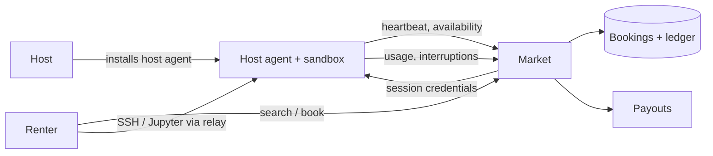

# Architecture — gpu-bnb

## 1. Scope
Peer-to-peer marketplace renting out idle GPUs by the hour.
**MVP:** listings with daily availability windows, search (filters + reliability-adjusted price),
overlap-safe booking, quotes with long-booking discount and fee, cancellation policy, completion
with interruption refunds, payouts.
**Product:** host agent (sandboxed containers, auto-pause), verified hardware, dynamic pricing, job-level rentals.

## 2. System context

## 3. Core invariants
- No overlapping confirmed bookings per listing (`a0 < b1 and b0 < a1`).
- Every booked hour falls inside the host's daily windows.
- `total = host_amount + fee`. Refunds are 100% if cancelled more than 24 h ahead or by the host,
  50% within 24 h, and 0% after the start. The host is paid 50% on late renter cancellations.
- Interruptions refund pro-rata and count against host reliability.

## 4. Design decisions
- **Ranking by `price / reliability`.** A cheap, flaky host loses to a slightly pricier, reliable one,
  which is how marketplaces avoid a race to the bottom.
- **Laplace-smoothed reliability** (`(delivered+2)/(delivered+failed+2)`), so new hosts aren't
  punished or over-trusted.
- **Hour-granular windows** in the MVP. The product moves to calendar intervals with timezone support.

## 5. Production architecture
Postgres with an exclusion constraint (`EXCLUDE USING gist (listing_id WITH =, tstzrange(start,end) WITH &&)`)
for double-booking safety at the DB level. A host agent runs workloads in gVisor/Kata with GPU
passthrough. A relay (WireGuard) avoids exposing host IPs. Payments via Stripe Connect.

## 6. Security
Renter code is untrusted, so it runs in a sandbox with no host filesystem access and egress limits.
Hosts are protected from crypto-mining abuse through workload policy and monitoring.

## 7. Risks
Consumer ISP upload limits and NAT, so the target market starts with workstation owners and
small labs. Reliability of residential power and network is reflected in pricing.
